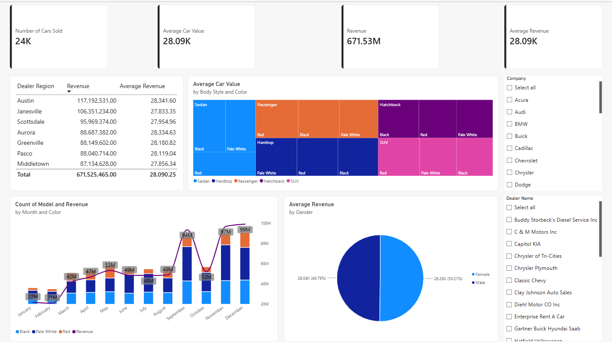

# Car Sales Performance Dashboard

A Power BI dashboard analyzing 24K vehicle sales across dealer regions, body styles, colors, and customer gender, built to show where revenue comes from and when it peaks.

## Business Question
Which regions, vehicle types, and months drive revenue, and how is average car value distributed across the product mix?

## Key Metrics
| KPI | Value |
|---|---|
| Cars Sold | 24K |
| Revenue | 671.53M |
| Average Car Value | 28.09K |
| Average Revenue | 28.09K |

## What the Dashboard Shows
- **Revenue and average revenue by dealer region**, ranked by total revenue
- **Treemap of average car value** by body style and color (Sedan, Hardtop, Passenger, Hatchback, SUV)
- **Monthly units sold by color** with a revenue line overlaid
- **Average revenue by gender**
- **Slicers** for company (make) and dealer name

## Observations
- Austin (117.2M) and Janesville (106.4M) lead all dealer regions by total revenue.
- Monthly revenue rises sharply in the second half of the year, with peaks in September and again in November and December.
- Average revenue is nearly identical for female (50.2%) and male (49.8%) buyers.

## Tools
Power BI, DAX, Power Query, data visualization (treemap, combo chart)

## Dataset
[Add the dataset source link here]
